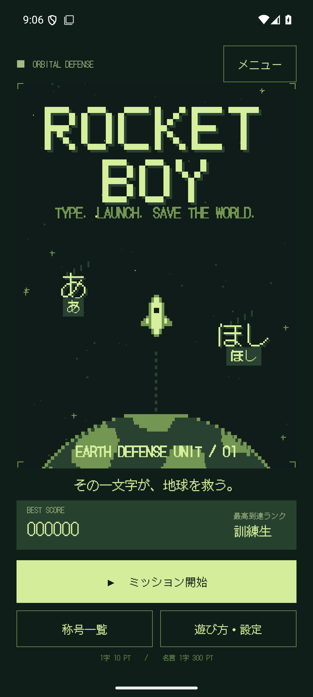
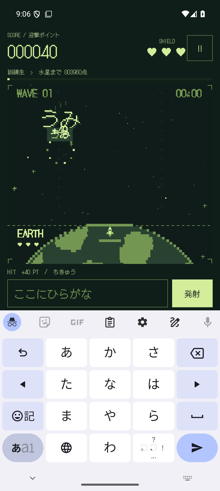
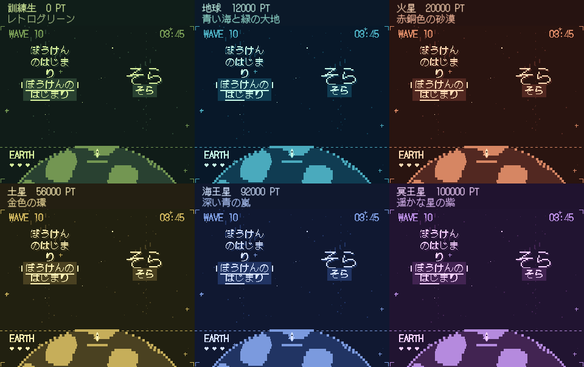
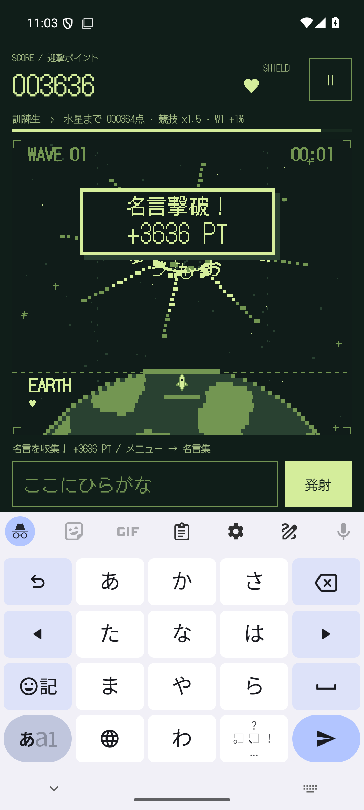
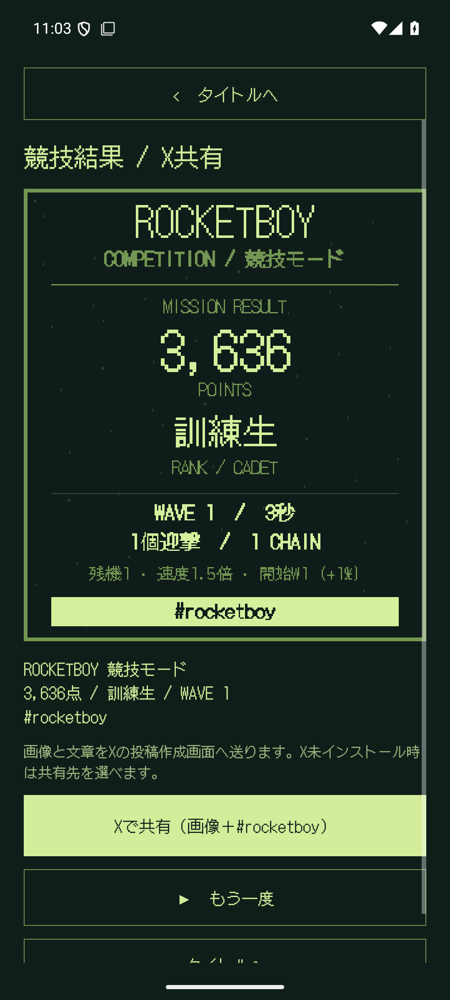
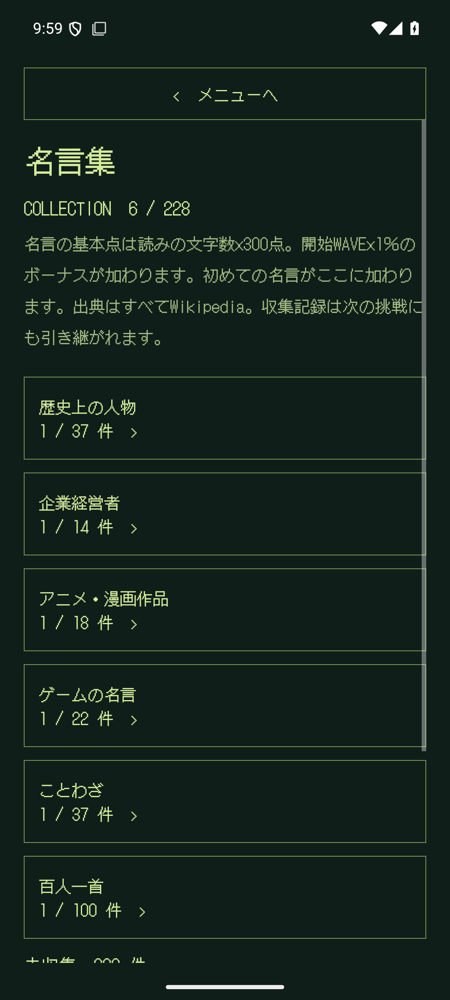
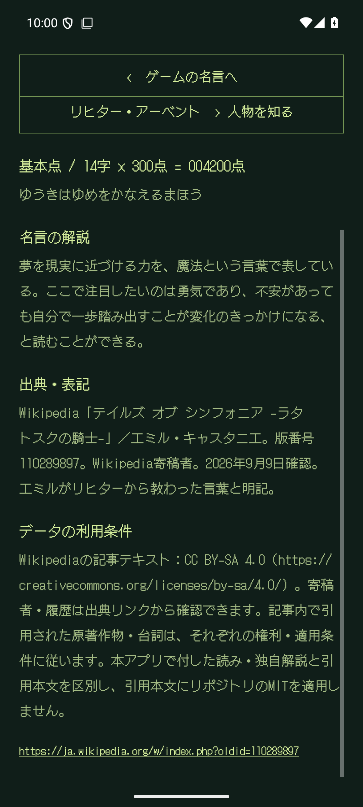
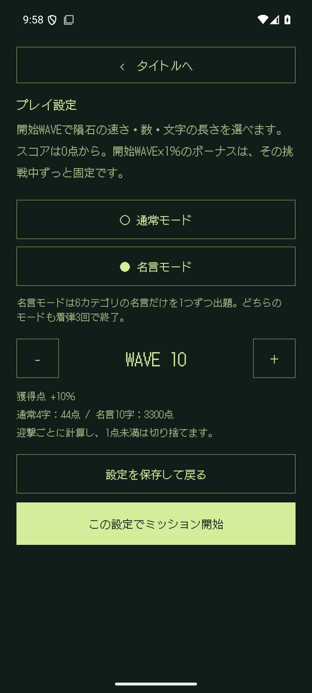
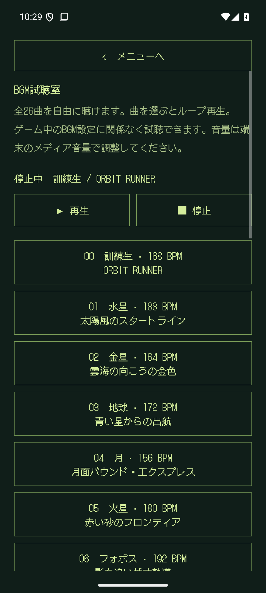
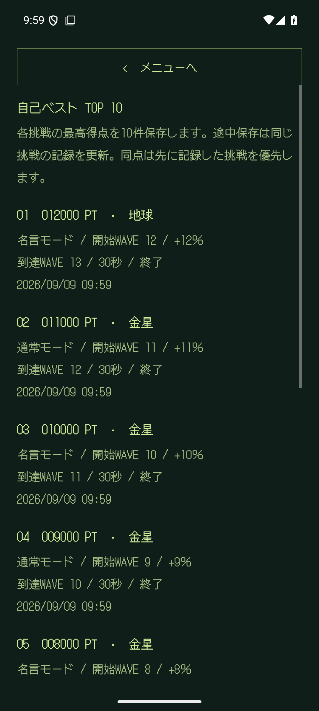

# ROCKETBOY

**その一文字が、地球を救う。**

Androidスマートフォン向け、縦画面固定の日本語タイピングゲームです。空から落ちる、ひらがなのかたちの隕石。ことばを入力して地上からロケットを発射し、地球を守ります。

<p align="center">
  
  
</p>

## 遊び方

1. 「ミッション開始」を押し、スマホのキーボードを日本語入力に切り替えます。
2. 隕石の下に表示されたことばを、ひらがなで入力します。
3. **入力を確定すると自動発射**。変換中のままでも、ゲーム内の「発射」またはキーボードの送信キーで発射できます。
4. ロケットが隕石に到達すると、通常のことばの基本点は **1字につき10点**。小さい「ゃ・ゅ・ょ・っ」も1字です。
   **名言の基本点は、入力するひらがなの読みの文字数×300点**。これに開始WAVE×1％のボーナスを加え、迎撃ごとに1点未満を切り捨てます。初めて迎撃した名言がコレクションに加わります。
5. 通常・名言モードは地上に**3回着弾するとゲームオーバー**。競技モードは**1回**で終了します。

濁点を入力している途中や漢字への変換途中では、自動発射しません。カタカナ・半角カタカナはひらがなに正規化します。誤入力は減点なし。CHAINは連続迎撃の表示で、スコア倍率はありません。同じことばの隕石は同時に出現しません。

隕石の下の読みには、入力済みの文字に合わせて下線が付きます。**1.4.2で、折り返した単語の2行目以降にも下線が続くよう修正**しました。短い最終行も文字の位置に合わせ、文字を削除すると下線も戻ります。[修正・検証記録](docs/validation-1.4.2.md)。

発射した隕石は迎撃予約となり、到達までの短いロケット演出中に地上へ落ちません。加点はロケット到達時の1回だけです。

## 星ごとに変わる配色（1.5.0）

プレイ中の到達ランクに合わせ、宇宙・地球・隕石・入力済みの下線・スコア・入力欄・ボタンの色が切り替わります。**訓練生の緑＋25天体の専用配色**。地球は青緑、火星は赤銅色、土星は金色、海王星は青、冥王星は紫など、天体をモチーフにした少数色のドット表示です。

4,000点ごとの昇格時に、その天体のBGMと配色へ切り替わります。名言の迎撃で複数ランク進んだ場合も、最終的な到達ランクの色を使います。入力途中の文字・変換状態を保ったまま色だけを更新します。

- プレイ・一時停止・結果・競技の共有用画像：その挑戦のスコアで決定。
- タイトル・メニュー：自己ベストの最高到達ランクで決定。
- 新しい挑戦・再挑戦：0点の訓練生の緑から開始。途中再開：保存したスコアの配色を復元。



実際のゲーム描画を検証用のスコアと配置で並べた比較です。スマホのキーボード自体の色はキーボードアプリの設定に従います。[全配色の一覧](docs/PALETTES.md) ／ [1.5.0の検証結果](docs/validation-1.5.0.md)。

## 難易度

通常・名言モードはタイトルの「設定」またはメニューの「プレイ設定」で開始WAVEを**1〜16**から選べます。スコアは**0点**で開始します。獲得点は `基本点 × (100 + 開始WAVE) ÷ 100` の整数部分です。WAVE 1は＋1％、WAVE 10は＋10％、WAVE 16は＋16％。プレイ中にWAVEが上がってもボーナス率は変わりません。

通常4字／名言10字の場合、WAVE 1開始は40点／3,030点、WAVE 10開始は44点／3,300点、WAVE 16開始は46点／3,480点です。設定画面で保存せず戻ると変更を破棄します。中断中の挑戦は元のモード・開始WAVEを維持し、その後の新規設定には影響されません。

**25秒ごと**にWAVEが上がり、隕石の出現頻度、落下速度、同時出現数、ことばの長さが増えます。

| WAVE | ことばの例 | 内容 |
|---|---|---|
| 1 | そら、ほし、つき | 2文字からスタート |
| 2–3 | そら、ほし、ちきゅう | 短いことば |
| 4–6 | ほしぞら、ながれぼし | 中くらいのことば |
| 7–9 | すいへいせん、ぎんがのはて | 長いことばへ移行 |
| 10以降 | うちゅうひこうし、ちきゅうをまもれ | 長いことば中心 |

初期の出現間隔は5.2秒、落下所要時間は約16秒（旧版の約27秒から約1.69倍の速度）、同時出現上限は2個。難易度の上限では出現間隔1.6秒、落下所要時間約10.9秒、同時出現上限6個になります。レーンの入口が空き、文字の表示領域が重ならなくなるまで出現を待つため、実際の出現数や間隔は画面の高さ、文字数、混雑状況にも左右されます。キーボードの高さが変わっても落下所要時間は変わりません。小さな画面ではスコア欄を縮め、プレイ領域を優先します。

## 競技モード・スコア画像の共有（1.4.0）

プレイ設定で「競技モード」を選ぶと、**通常モードの初期条件・開始WAVE 1・0点・残機1**で始まります。開始WAVEは固定です。通常のことばと名言が出現し、**どちらも同じWAVEの通常モードの1.5倍**の速さで落下します。出現間隔・同時出現上限・お題の進行は通常モードと同じ。1回着弾するとゲームオーバーです。

基本点は通常10点/字・名言300点/字、開始WAVE 1の**+1％**を適用します。1.5倍は落下速度の倍率です。WAVEが上がっても+1％は固定。再挑戦は再びWAVE 1・0点・残機1に戻ります。中断・再開時には競技条件を保持し、TOP 10にも「競技モード」として記録します。

終了時に**競技結果 / X共有**画面を表示します。表示したスコアカードと同じ内容を960×1080pxのPNGとして用意し、得点・称号・到達WAVE・経過時間・迎撃数・最大CHAIN・競技条件・`#rocketboy`を含めます。「この挑戦を終了」で終了した場合は画像と文章に「途中終了」と表示します。

「Xで共有（画像＋#rocketboy）」を押すと、Xアプリがインストールされている場合はXに画像と投稿文を渡します。Xがない場合はAndroidの共有先選択を開きます。最終的な投稿は共有先で行います。共有画面から戻る・画面を再生成する場合も同じ結果を保持し、二重に記録しません。画像はアプリのキャッシュに保存し、共有先にその画像だけの一時的な読み取り権限を渡します。ストレージ権限・ネットワーク権限の追加はありません。

 

エミュレーターの実画面です。名言・隕石の位置は演出と共有の検証用に準備しています。[1.4.0の検証結果](docs/validation-1.4.0.md)。

## 名言コレクション（6カテゴリ）

**名言の出典はすべてWikipediaです。1.3.0では本文と人物・作品への帰属を確認した56件を追加し、228件になりました。** 日本語版Wikipedia内の12検索（各最大40記事・重複を除いて423記事）、既存候補記事と追加の人物・作品記事を調べました。全Wikipediaの網羅や3,000件への到達はしていません。[調査範囲と追加記録](data/quotes/wikipedia-expansion.json)に実数を示しています。
各項目に個別の解説、記事名、確認した版へのリンク、表記・利用条件を付けています。
[採用・削除の基準と出典一覧](docs/WIKIPEDIA_QUOTES.md) ／ [実数集計](data/quotes/inventory.json)。

| カテゴリ | 収録数 |
|---|---:|
| 歴史上の人物 | 37 |
| 企業経営者 | 14 |
| アニメ・漫画作品 | 18 |
| ゲームの名言 | 22 |
| ことわざ | 37 |
| 百人一首 | 100 |
| **合計** | **228** |

**メニュー → 名言集 → カテゴリ → 獲得した名言** の順で、言葉・読み・解説・出典をたどれます。
人物名から紹介と関連する収集済みの名言も開けます。カテゴリごとの収集数と総数を表示し、収集済みの項目を本文・読み・作品名・人物名・解説で検索できます。
30件ずつのページ表示で、名言から戻っても検索条件とページを維持します。百人一首は上の句・下の句を合わせた一首を1件とし、全100首に個別の解説を付けています。

 

画面はエミュレーターの実画面です。収集状態はUI検証用に準備しています。[1.3.0の検証結果](docs/validation-1.3.0.md)。

収集後の閲覧はオフラインです。出典リンクを自分で開いた場合だけ、外部ブラウザーで参照先へ移動します。

- 通常モードでは名言はプレイ時間25秒以降、既存の隕石がなくなったところで1個ずつ登場。その後は前回の出現から35秒以降が目安です。
- 「名言 / 獲得ポイント」の枠に表示した読みを、改行・句読点を入れずにひらがなで入力。途中まで確定しても、全文が一致するまで発射しません。
- 読みは最大64文字。画面の高さが足りないときは、入力に合わせて続きの行を表示します。文字は16pxのドット表示を維持します。長文用に画面幅を使い、出現中は通常の隕石を追加しません。基準の落下時間は `16秒 + 読みの文字数 × 0.30秒` で、現在のWAVEの速度に合わせて短くなります。
- **ロケット命中で読みの文字数×300点を基本点として開始WAVEのボーナスを加算**。漢字を含む本文の文字数ではなく、入力するひらがなの文字数で数えます。通常隕石の点数との二重加算はありません。
- 初めて命中させた名言を保存。取り逃したものや発射しただけのものは収集されません。同じ名言を再び倒した場合も同じ配点ですが、コレクションは重複しません。
- 未収集の名言を優先して出現させます。収集記録はゲームオーバー・再挑戦・アプリ再起動をまたいで保存します。
- 旧版の途中セーブ、最高スコア、BGM・効果音の設定を引き継ぎます。削除対象の名言はコレクションと出現候補から外し、保存中に飛行している場合も、その隕石だけを除いて再開します。削除による加点・減点・着弾ダメージはありません。

名言には著作中の文章、弟子が伝えた言葉、綱領、物語の台詞、伝承のことわざ、和歌を含みます。各項目にWikipedia掲載表記・一部抜粋・和歌のルビ除去などの区別を明記し、解説は個別に執筆しています。[出典と表記方針](docs/QUOTES.md)を参照してください。

## 名言モード・BGM試聴・TOP 10

- **名言モード**：プレイ設定で選択。開始から6カテゴリの名言だけが1つずつ出現し、通常のことばは出現しません。未収集の名言を優先し、着弾3回で終了します。
- **BGM試聴室**：メニューから全26曲（訓練生1曲＋天体25曲）を選び、ランク未到達でも自由にループ再生できます。ゲームBGMがOFFでも試聴可能です。停止・画面から戻る・バックグラウンド移動で再生を止めます。
- **自己ベストTOP 10**：メニューまたはタイトルのBEST SCORE欄から開きます。各挑戦の最高得点を10件保存し、称号、モード、開始WAVE、ボーナス、到達WAVE、時間、記録日を表示します。途中保存は同じ挑戦の記録を更新します。同点は先に記録した挑戦を優先。旧版の自己ベスト1件も維持しますが、過去に記録されていない9件を復元することはできません。

  

## 称号

**称号は1回のプレイのスコアで判定します。プレイ間の累積点ではありません。** 最高スコアと最高到達ランクは端末に保存します。名言の得点も称号の判定に含まれます。0〜3,999点は「訓練生」。代表的な25天体を採用し、100,000点を25等分した**4,000点ごと**に昇格します。

| 点数 | 称号 | 点数 | 称号 |
|---:|---|---:|---|
| 4,000 | 水星 | 56,000 | 土星 |
| 8,000 | 金星 | 60,000 | エンケラドゥス |
| 12,000 | 地球 | 64,000 | レア |
| 16,000 | 月 | 68,000 | タイタン |
| 20,000 | 火星 | 72,000 | イアペトゥス |
| 24,000 | フォボス | 76,000 | 天王星 |
| 28,000 | ダイモス | 80,000 | アリエル |
| 32,000 | ケレス | 84,000 | チタニア |
| 36,000 | 木星 | 88,000 | オベロン |
| 40,000 | イオ | 92,000 | 海王星 |
| 44,000 | エウロパ | 96,000 | トリトン |
| 48,000 | ガニメデ | **100,000** | **冥王星** |
| 52,000 | カリスト | | |

親惑星の平均的な太陽からの距離で天体系を並べ、同じ天体系では惑星を先に、その衛星を内側から並べています。衛星の瞬間的な太陽からの距離は軌道上で変わるため、これはゲーム用の順序です。太陽系の全衛星を網羅した表ではありません。冥王星を最上位とし、冥王星より遠い準惑星は採用していません。

天体名・分類・体系の参考：[NASA Solar System](https://science.nasa.gov/solar-system/)、[Jupiter Moons](https://science.nasa.gov/jupiter/jupiter-moons/)、[Saturn Moons](https://science.nasa.gov/saturn/moons/)、[Uranus Moons](https://science.nasa.gov/uranus/moons/)。画像や解説本文は取り込んでいません。

## 表現・サウンド

- 緑を基調とした4色の宇宙、ロケット、地球、ひらがなの隕石、破片のドット描画。
- 320論理ピクセル幅のCanvasを、補間なしで拡大表示。
- 名言撃破時は約1.6秒の専用エフェクト。二重の衝撃波・8方向の光線・40個の破片・飛び散るひらがな・大きな得点表示を重ねます。全モード共通で、演出中もゲームの時間・当たり判定は通常どおり進みます。
- 日本語ドットフォント **DotGothic16** を同梱。通信なしで表示できます。
- **25天体の専用曲「CELESTIAL ADVENTURE」全25曲**。1.3.1ですべて作り直しました。ZUN進行の基本形（♭VI → ♭VII → i）を軸にした、宇宙を冒険する曲です。152〜194 BPM、各64小節、約79〜101秒のループ。訓練生の「ORBIT RUNNER」は変更していません。
- 昇格時に到達した天体の曲へ切り替えます。名言で複数段階を越えた場合は到達先の曲へ直接切り替え、中断したミッションも保存されたスコアに対応する曲で再開します。
- 矩形波2声、32サンプル・4bit波形メモリのベース、LFSRノイズの4声で作ったゲームボーイ風の音源。[全25曲の曲名・天体モチーフ・テンポ](docs/SOUNDTRACK.md)。
- 発射・迎撃・着弾・ランクアップ・ゲームオーバーの電子音。
- BGMと効果音をそれぞれON/OFF。端末のメディア音量に従います。

BGM・効果音・ロケット・背景は本ゲーム用のオリジナルです。既存ゲームの曲、音源、画像、ROMからの抽出素材は含みません。既存の訓練生BGM・効果音は `python3 tools/generate_audio.py`、新曲25曲は `python3 tools/music/render.py`（NumPyとFFmpegが必要）で再生成できます。

## 一時停止と記録

一時停止、バックグラウンドへの移動、画面ロック、音声フォーカスの喪失でゲームと音を止めます。キーボードを閉じたときも一時停止します。再開は3秒のカウントダウン付きです。

スコア、経過時間、残りシールド、出現中のことば・位置・ロケット進行度を保存。発射・迎撃・着弾時、定期チェックポイント、通常の中断時に記録します。OSによる突然の強制終了では最後の保存地点からの再開になります。入力途中の未確定文字は、プロセス終了後の復元対象に含みません。名言の種類・次の出現時刻・収集記録も保存し、飛行中のロケットを復元しても重複して加点しません。

1.2.0以降の基本点は通常10点/字、名言300点/字です。1.3.0では開始WAVE×1％のボーナスを加えます。更新前に保存した得点・自己ベストは数値を維持し、以降の迎撃から新しい配点で加点します。

広告、課金、アカウント、アプリ本体のネットワーク通信、解析SDKはありません。アプリにインターネット権限はありません。

## 開発

- Kotlin / Android Views + Canvas
- Android 8.0（API 26）以上、compile/target SDK 36
- JDK 17、Gradle 8.14.3、Android Gradle Plugin 8.13.0
- パッケージ：`io.github.hatake716.rocketboy`

Android Studioで開くか、SDKの場所を `local.properties` に指定します。

```properties
sdk.dir=/path/to/Android/Sdk
```

```bash
./gradlew :app:assembleDebug :app:testDebugUnitTest :app:lintDebug
./gradlew :app:assembleDebugAndroidTest :app:connectedDebugAndroidTest
./gradlew :app:assembleRelease :app:bundleRelease :app:lintRelease
```

試用用debug APKは `app/build/outputs/apk/debug/app-debug.apk`。releaseはローカルの `keystore.properties` がある場合にアップロード鍵で署名します。設定例は `keystore.properties.example`。秘密鍵とパスワードはリポジトリに含めません。設定がない環境のrelease出力は未署名で、公開用には使えません。

NixOSでは、Nixで提供するaapt2を使ってビルドできます。

```bash
./gradlew :app:assembleDebug -Pandroid.aapt2FromMavenOverride=/absolute/path/to/nix/aapt2
```

テストの対象と実行結果は [docs/VALIDATION.md](docs/VALIDATION.md) に記録します。UIテストはエミュレーター上のこのアプリのテストデータを初期化します。日常利用中の端末では実行しないでください。

## 構成

| ファイル | 役割 |
|---|---|
| `GameEngine.kt` | Android非依存のゲーム進行、入力判定、出現、難易度、得点 |
| `Quotes.kt` / `app/src/main/resources/quotes/` | 6カテゴリの名言、読み、人物紹介、解説、出典、検索 |
| `data/quotes/` / `tools/quotes/build_catalog.py` | 編集元データ、オフライン同梱データの生成、重複と件数の検査 |
| `Ranks.kt` | 25天体と正確な昇格境界 |
| `KanaInput.kt` | Android IMEの確定・変換中入力との接続 |
| `PixelScene.kt` | ピクセル描画、ロケット軌跡、迎撃演出 |
| `MainActivity.kt` | 画面、ライフサイクル、一時停止、操作 |
| `SessionStore.kt` | 挑戦の保存・再開、最高記録、設定 |
| `ChipAudio.kt` / `CelestialMusic.kt` | ランク別BGM、効果音、音声フォーカス、非同期の音源準備 |
| `Scoring.kt` | 通常10点/字・名言300点/字の得点計算 |
| `tools/music/` / `data/music/tracks.json` | 新曲25曲の譜面、4声合成、音源の検証値 |
| `tools/generate_audio.py` | 再現可能な音源生成 |

## ライセンス

コードとオリジナル素材は [MIT License](LICENSE)。第三者の名言・作品の台詞に本リポジトリのMITを適用するものではありません。Wikipediaの記事テキストの利用条件はCC BY-SA 4.0です。記事内に引用された第三者の文章と古典原文は、それぞれの条件に従います。詳細は [Wikipediaの利用表示](app/src/main/assets/licenses/Wikipedia-Reuse.txt)。以前から使用している入力用の読み等に対応して、The UnlicenseとMITの参照データの表示も保持しています。DotGothic16はFontworks Inc.による **SIL Open Font License 1.1**。フォントのライセンスは [同梱ファイル](app/src/main/assets/licenses/DotGothic16-OFL.txt) とゲーム内「遊び方・設定 → フォント・名言データのライセンス」から確認できます。[素材の出典](docs/ASSETS.md) も参照してください。

## Google Play更新準備（1.5.0 / code 10）

星ごとの配色を反映した署名付きAAB・APK、ストア掲載文・更新履歴、新規撮影の画像8枚、更新手順を用意しました。提出用一式は `artifacts/ROCKETBOY-GooglePlay-1.5.0.zip`。[更新ガイド](docs/PLAY_STORE.md)と[検証結果](docs/PLAY_VALIDATION.md)を参照してください。以前の1.4.1 ZIPは保持しています。

サポートは acesmash@gmail.com、対象は子どもを含む全年齢の方針です。既存の[内容確認表](docs/PLAY_CONTENT_REVIEW.md)と申告案を引き継いでいます。今回、Google Playへのアップロード・審査送信は行っておらず、Consoleの現在の登録内容は未確認です。プライバシーポリシーは [GitHub Pages](https://hatake716.github.io/rocketboy/privacy/) で公開済みです。
