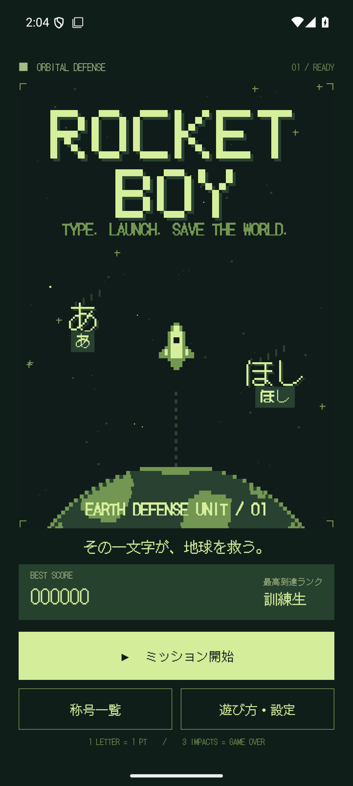
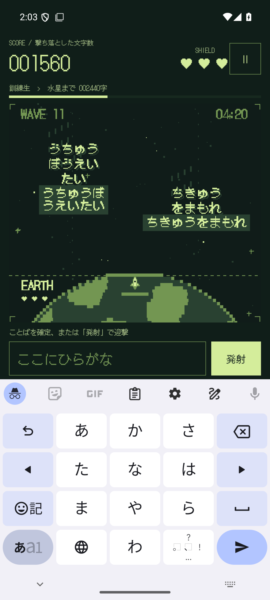

# ROCKETBOY

**その一文字が、地球を救う。**

Androidスマートフォン向け、縦画面固定の日本語タイピングゲームです。空から落ちる、ひらがなのかたちの隕石。ことばを入力して地上からロケットを発射し、地球を守ります。

<p align="center">
  
  
</p>

## 遊び方

1. 「ミッション開始」を押し、スマホのキーボードを日本語入力に切り替えます。
2. 隕石の下に表示されたことばを、ひらがなで入力します。
3. **入力を確定すると自動発射**。変換中のままでも、ゲーム内の「発射」またはキーボードの送信キーで発射できます。
4. ロケットが隕石に到達すると、**1字につき1点**。小さい「ゃ・ゅ・ょ・っ」も1字です。
5. 隕石が地上に**3回着弾するとゲームオーバー**になります。

濁点を入力している途中や漢字への変換途中では、自動発射しません。カタカナ・半角カタカナはひらがなに正規化します。誤入力は減点なし。CHAINは連続迎撃の表示で、スコア倍率はありません。同じことばの隕石は同時に出現しません。

発射した隕石は迎撃予約となり、到達までの短いロケット演出中に地上へ落ちません。加点はロケット到達時の1回だけです。

## 難易度

**25秒ごと**にWAVEが上がり、隕石の出現頻度、落下速度、同時出現数、ことばの長さが増えます。

| WAVE | ことばの例 | 内容 |
|---|---|---|
| 1 | あ、か、が | 1字から練習 |
| 2–3 | そら、ほし、ちきゅう | 短いことば |
| 4–6 | ほしぞら、ながれぼし | 中くらいのことば |
| 7–9 | すいへいせん、ぎんがのはて | 長いことばへ移行 |
| 10以降 | うちゅうひこうし、ちきゅうをまもれ | 長いことば中心 |

初期の出現間隔は5.2秒、落下所要時間は約27秒、同時出現上限は2個。難易度の上限では出現間隔1.6秒、落下所要時間約10.9秒、同時出現上限6個になります。レーンの入口が空き、文字の表示領域が重ならなくなるまで出現を待つため、実際の出現数や間隔は画面の高さ、文字数、混雑状況にも左右されます。キーボードの高さが変わっても落下所要時間は変わりません。小さな画面ではスコア欄を縮め、プレイ領域を優先します。

## 称号

**称号は1回のプレイのスコアで判定します。プレイ間の累積点ではありません。** 最高スコアと最高到達ランクは端末に保存します。0〜3,999点は「訓練生」。代表的な25天体を採用し、100,000点を25等分した**4,000点ごと**に昇格します。

| 点数 | 称号 | 点数 | 称号 |
|---:|---|---:|---|
| 4,000 | 水星 | 56,000 | 土星 |
| 8,000 | 金星 | 60,000 | エンケラドゥス |
| 12,000 | 地球 | 64,000 | レア |
| 16,000 | 月 | 68,000 | タイタン |
| 20,000 | 火星 | 72,000 | イアペトゥス |
| 24,000 | フォボス | 76,000 | 天王星 |
| 28,000 | ダイモス | 80,000 | アリエル |
| 32,000 | ケレス | 84,000 | チタニア |
| 36,000 | 木星 | 88,000 | オベロン |
| 40,000 | イオ | 92,000 | 海王星 |
| 44,000 | エウロパ | 96,000 | トリトン |
| 48,000 | ガニメデ | **100,000** | **冥王星** |
| 52,000 | カリスト | | |

親惑星の平均的な太陽からの距離で天体系を並べ、同じ天体系では惑星を先に、その衛星を内側から並べています。衛星の瞬間的な太陽からの距離は軌道上で変わるため、これはゲーム用の順序です。太陽系の全衛星を網羅した表ではありません。冥王星を最上位とし、冥王星より遠い準惑星は採用していません。

天体名・分類・体系の参考：[NASA Solar System](https://science.nasa.gov/solar-system/)、[Jupiter Moons](https://science.nasa.gov/jupiter/jupiter-moons/)、[Saturn Moons](https://science.nasa.gov/saturn/moons/)、[Uranus Moons](https://science.nasa.gov/uranus/moons/)。画像や解説本文は取り込んでいません。

## 表現・サウンド

- 緑を基調とした4色の宇宙、ロケット、地球、ひらがなの隕石、破片のドット描画。
- 320論理ピクセル幅のCanvasを、補間なしで拡大表示。
- 日本語ドットフォント **DotGothic16** を同梱。通信なしで表示できます。
- オリジナルBGM **「ORBIT RUNNER」**。168 BPM、Eマイナー、32小節のループ。
- 矩形波2声、三角波ベース、ノイズドラムを組み合わせた、スピード感のあるチップチューン。
- 発射・迎撃・着弾・ランクアップ・ゲームオーバーの電子音。
- BGMと効果音をそれぞれON/OFF。端末のメディア音量に従います。

BGM・効果音・ロケット・背景は本ゲーム用のオリジナルです。既存ゲームの曲、音源、画像、ROMからの抽出素材は含みません。音源は `python3 tools/generate_audio.py` で再生成できます。

## 一時停止と記録

一時停止、バックグラウンドへの移動、画面ロック、音声フォーカスの喪失でゲームと音を止めます。キーボードを閉じたときも一時停止します。再開は3秒のカウントダウン付きです。

スコア、経過時間、残りシールド、出現中のことば・位置・ロケット進行度を保存。発射・迎撃・着弾時、定期チェックポイント、通常の中断時に記録します。OSによる突然の強制終了では最後の保存地点からの再開になります。入力途中の未確定文字は、プロセス終了後の復元対象に含みません。

広告、課金、アカウント、ネットワーク通信、解析SDKはありません。アプリにインターネット権限はありません。

## 開発

- Kotlin / Android Views + Canvas
- Android 8.0（API 26）以上、compile/target SDK 36
- JDK 17、Gradle 8.14.3、Android Gradle Plugin 8.13.0
- パッケージ：`io.github.hatake716.rocketboy`

Android Studioで開くか、SDKの場所を `local.properties` に指定します。

```properties
sdk.dir=/path/to/Android/Sdk
```

```bash
./gradlew :app:assembleDebug :app:testDebugUnitTest :app:lintDebug
./gradlew :app:assembleDebugAndroidTest :app:connectedDebugAndroidTest
./gradlew :app:assembleRelease :app:bundleRelease :app:lintRelease
```

試用できる署名付きdebug APKは `app/build/outputs/apk/debug/app-debug.apk`。`release` は署名設定を同梱していないため未署名です。Google Play公開用の鍵や公開処理はこのリポジトリに含みません。

NixOSでは、Nixで提供するaapt2を使ってビルドできます。

```bash
./gradlew :app:assembleDebug -Pandroid.aapt2FromMavenOverride=/absolute/path/to/nix/aapt2
```

テストの対象と実行結果は [docs/VALIDATION.md](docs/VALIDATION.md) に記録します。UIテストはエミュレーター上のこのアプリのテストデータを初期化します。日常利用中の端末では実行しないでください。

## 構成

| ファイル | 役割 |
|---|---|
| `GameEngine.kt` | Android非依存のゲーム進行、入力判定、出現、難易度、得点 |
| `Ranks.kt` | 25天体と正確な昇格境界 |
| `KanaInput.kt` | Android IMEの確定・変換中入力との接続 |
| `PixelScene.kt` | ピクセル描画、ロケット軌跡、迎撃演出 |
| `MainActivity.kt` | 画面、ライフサイクル、一時停止、操作 |
| `SessionStore.kt` | 挑戦の保存・再開、最高記録、設定 |
| `ChipAudio.kt` | BGM、効果音、音声フォーカス |
| `tools/generate_audio.py` | 再現可能な音源生成 |

## ライセンス

コードとオリジナル素材は [MIT License](LICENSE)。DotGothic16はFontworks Inc.による **SIL Open Font License 1.1**。フォントのライセンスは [同梱ファイル](app/src/main/assets/licenses/DotGothic16-OFL.txt) とゲーム内「遊び方・設定 → フォントライセンス」から確認できます。[素材の出典](docs/ASSETS.md) も参照してください。
