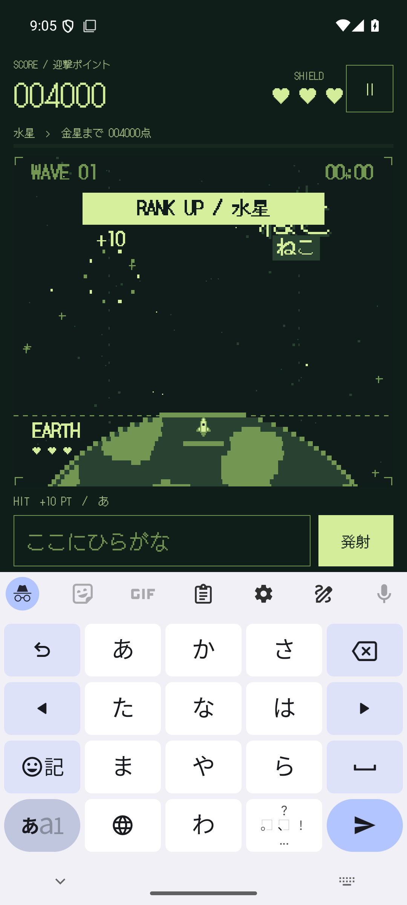
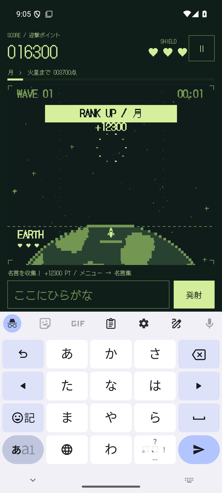
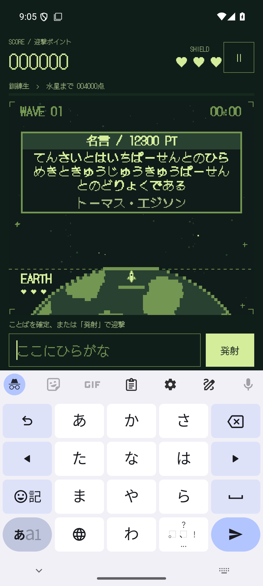
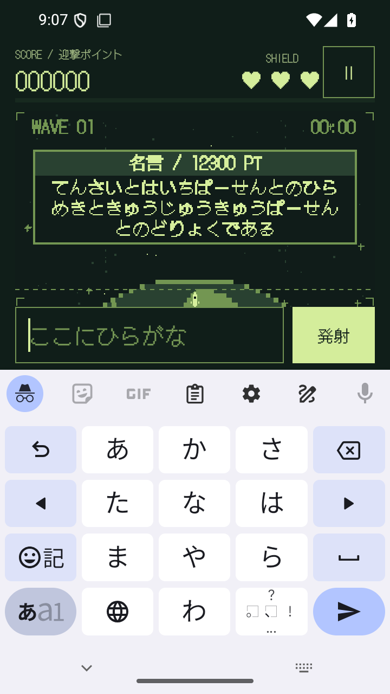
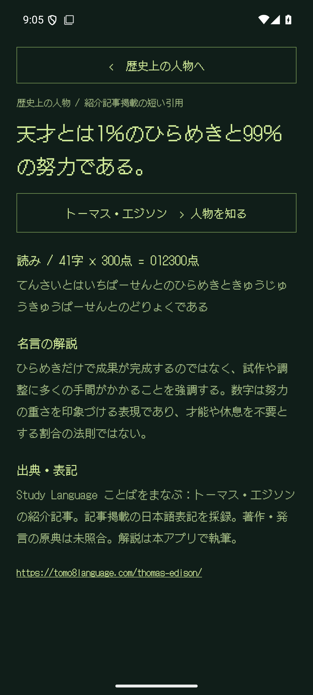
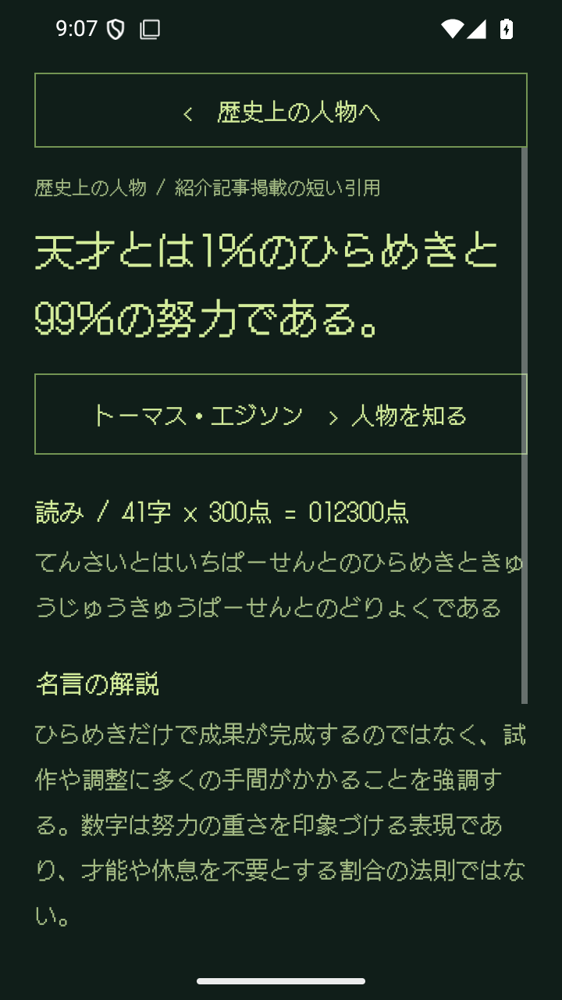

# ROCKETBOY 1.2.0 — 得点更新と天体別BGM25曲

2026-09-09。versionCode 3。 [機械可読の結果](validation-1.2.0.json)。

## 変更した動作

- 通常隕石は読みの1字につき10点、名言は読みの1字につき300点。小さい仮名も1字。
- 迎撃が完了した時点で1回だけ加点。名言の本文中の漢字数や句読点は数えない。
- 称号は1プレイの得点。4,000点刻み、100,000点で冥王星。旧セーブの数値は維持し、次の迎撃から新配点。
- 25天体それぞれの新曲を制作し、昇格時に切り替える。訓練生は既存ORBIT RUNNER。
- 名言で複数段階を越えると到達先の曲へ直接切り替え。ミュート、音声フォーカス、保存・再開、新規プレイに対応。
- 非同期で次の曲を準備し、前のMediaPlayerは解放。結果画面への移動中に準備が終わってもBGMを再開しない。
- タイトル・プレイ中・名言の説明・遊び方・設定・READMEの配点と音楽の表示を更新。
- 名言データ361件のTSVは前回APKとバイト一致。既存の名言・読み・ID・説明を変更していない。

## 音源

[全25曲の曲目と天体モチーフ](SOUNDTRACK.md)。158〜190 BPM、各32小節、約40〜49秒、合計18分24秒。
4つずつ計100個の異なる主題から展開を作る。矩形波2声・4bit波形メモリ・LFSRノイズの4声。
ソフトウェア合成のゲームボーイ風音源で、実機APUの完全再現や実機録音ではない。

生成PCMと同梱OggのSHA-256、長さ、波形ピーク値を `data/music/tracks.json` に保存。
APK内の25ファイルと照合。全曲をFFmpegでデコードし、長さ・先頭/末尾の有音・クリッピングなしを検証。
最大ピークは 0.9278（フルスケール1.0）、ループ端の最大差は 0.01056。
さらにAndroid MediaPlayerで各曲を再生し、末尾付近へシークしてループ後も再生が続くことを全25曲で検証。

試聴用は `artifacts/1.2.0/ROCKETBOY-25-tracks-sampler.mp3`（約2分22秒、天体の順に4小節ずつ）。
全曲Oggと曲目・プレイリストは `ROCKETBOY-CELESTIAL-STAGES-25-tracks.zip`。

## ビルドと動作確認

`assembleDebug`、`assembleDebugAndroidTest`、`testDebugUnitTest`、`lintDebug` 成功。
単体テスト32件、lintエラー0・警告24件。

Android 15 / API 35 のエミュレーターで全26件成功（GameFlowTest 25件、全25曲を検証するMusicPlaybackTest 1件）。
通常入力、濁点・小書き文字、到達時のみの加点、二重加点防止、旧セーブ、名言コレクション、検索、解説も回帰確認。

音楽の統合検証では通常迎撃で3,990→4,000点・水星曲に切り替え、41字の名言でさらに12,300点を加算して16,300点・月曲へ移動。
停止中は再生位置が進まず、Activity再作成後も保存したランクの曲が流れる。ゲームオーバーで停止し、再挑戦で訓練生の曲に戻る。
ミュート状態で冥王星へ昇格した後にONにすると冥王星の曲が流れ、同じランク内の得点変化では曲の再生をリセットしない。

720×1280・320dpiでは最長名言の得点表示・迎撃・保存・説明画面を追加1件で確認し、実画面も目視確認。
検証後に1080×2400・420dpiへ戻した。画面のスコア・収集状況は検証用に設定したものを含む。

## 配布APKと実機更新

- APK: `artifacts/1.2.0/ROCKETBOY-1.2.0-debug.apk`
- サイズ: 21,296,160 bytes（約21.3 MB）
- SHA-256: `e60da33e5ca27b469b27797bb614ef1924ee2ca9456aeca8a4869e924a3044ba`
- Android debug署名 / APK Signature Scheme v2 検証成功。
- エミュレーターに再インストールし、導入済みAPKと成果物のハッシュ一致を確認。
- Pixel 10aへ `adb install --no-incremental -r` で1.1.0から更新。versionName 1.2.0 / code 3と同一APKハッシュを確認。
- 更新前後の保存設定XMLがバイト一致。スコア・コレクション・設定を保持。
- 実機で起動成功（Status: ok）。実機への自動入力は行っておらず、操作感・聴感の最終確認はユーザーによる確認待ち。
- 本番署名による配布、Play公開、GitHubへのpushはこの作業では行っていない。

## 実画面

 

 

 
