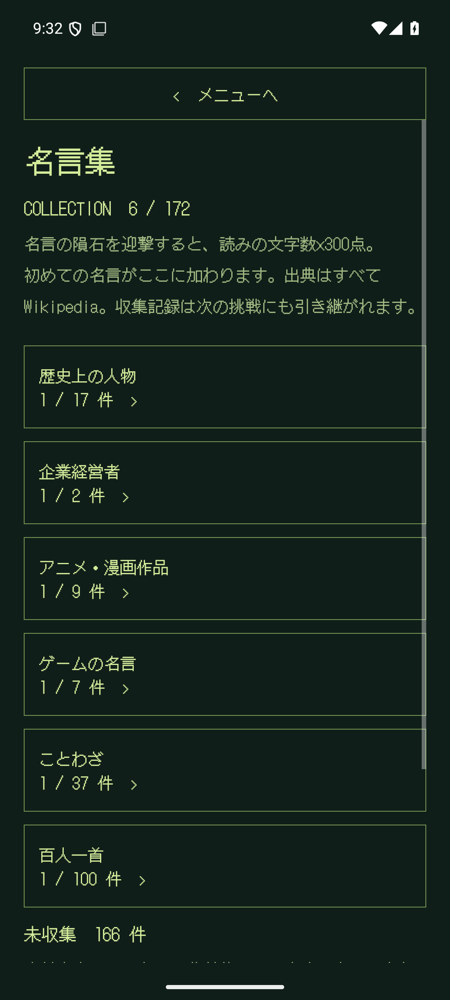
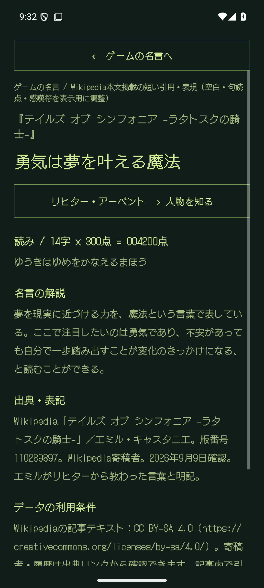
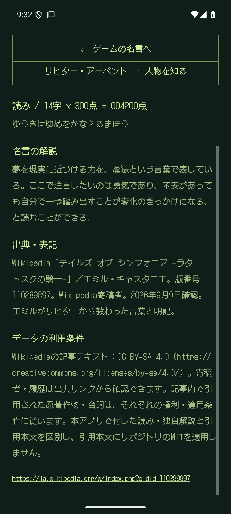
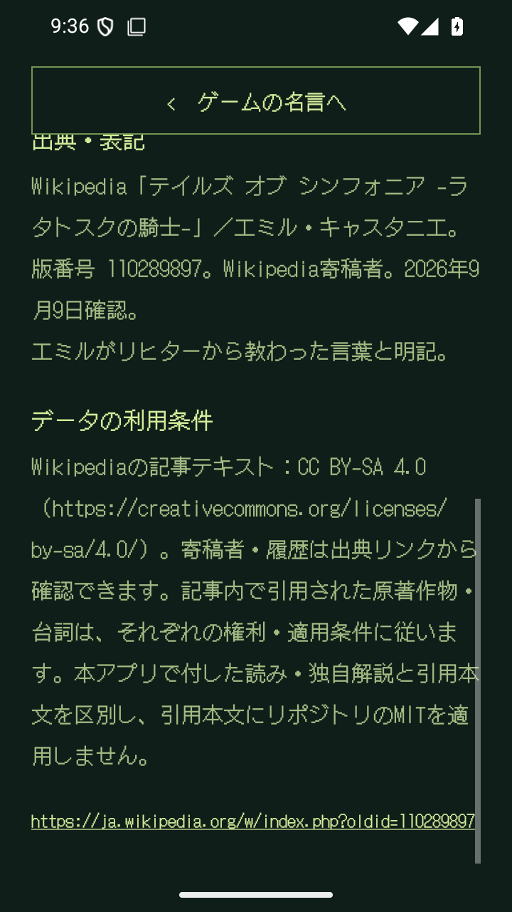

# ROCKETBOY 1.2.1 — 名言の出典をWikipediaに統一

2026-09-09。versionCode 4。[機械可読の結果](validation-1.2.1.json)。

## 変更内容と出典照合

旧361件から、日本語版Wikipedia本文で掲載表記と人物・作品への帰属を確認できた172件を収録。189件を出題・コレクションから削除しました。
内訳は歴史17・企業2・アニメ漫画9・ゲーム7・ことわざ37・百人一首100です。
全件に独自解説、記事名、固定版へのリンク、表記変更の説明、利用条件を付けています。
[全件の出典と採否基準](WIKIPEDIA_QUOTES.md)、[採用・削除記録](../data/quotes/wikipedia-audit.json)。

固定版の70記事を再取得し、全172件を照合、失敗0件。脚注・参考文献・外部リンクの題名等を除いた記事本文でも一致を確認しました。
単なる人物・作品記事の存在、題名のみの一致、別人物の表現、ウィクショナリーへの案内だけのページは採用理由にしていません。

百人一首はWikipedia掲載の表記へ統一。44番は「藤原朝忠」記事の本文を採用。49番は「夜はもえて」に合わせて読みの「て」を補いました。
「情けは人の為ならず」は記事本文の漢字表記に統一し、入力用の読みは維持しています。

## 保存データと回帰確認

削除対象の旧ID・読みのみを移行判定に使用し、本文・解説はAPKの出題・閲覧データに含めません。
保存ミッションの削除名言だけを除去して再開し、スコア・最高記録・シールド・経過時間・他の隕石・設定を維持します。削除による加点や着弾ダメージはありません。
49番は収集記録を維持し、古い読みで飛行中の隕石だけを除去。新しい読みでの保存・再開も確認しました。

`assembleDebug`、`assembleDebugAndroidTest`、`testDebugUnitTest`、`lintDebug` 成功。
単体テスト29件成功。Lintエラー0、既存警告24件。

Android 15 / API 35エミュレーター、1080×2400・420dpiで25件成功。
6カテゴリの検索・解説・Wikipediaリンク・利用条件、保存データ移行、Gboard入力、加点、一時停止・復元、ゲームオーバー、ランク別BGMを確認。
25曲のAndroid上での再生・ループも従来の回帰テストで成功しています。

720×1280・320dpiでは、全6カテゴリの出典画面と、最長33文字の名言の入力・迎撃・保存・解説について2件成功。実画面を目視確認し、検証後に1080×2400・420dpiへ戻しました。
画面内の収集状態やスコアには、検証用に設定したデータを含みます。実機への自動入力は行っていません。

## 配布APKと実機更新

- APK: `artifacts/1.2.1/ROCKETBOY-1.2.1-debug.apk`
- サイズ: 21,291,982 bytes（約21.3 MB）
- SHA-256: `0d316ce88276009326e3309883ac0c5ed7ac19e4cc171b211a954d53919ee2b7`
- Android debug署名、APK Signature Scheme v2の検証成功。
- APKの名言TSVは生成元と一致。全172件の出典URLがWikipedia、削除189件のIDが出題データにないことを確認。
- 25曲のBGMは1.2.0のAPKとバイト一致。
- エミュレーターへ最終APKを再インストールし、導入済みAPKのハッシュ一致を確認。
- Pixel 10aへ1.2.0から更新インストール。1.2.1 / code 4、APKのハッシュ一致、起動成功を確認。
- 更新直前・直後の保存設定XMLがバイト一致。実機での操作感の確認はユーザーによる確認待ち。
- 今回作成した配布物はインストール用debug APK。Play公開やGitHubへのpushは行っていません。

## 実画面

 

 
