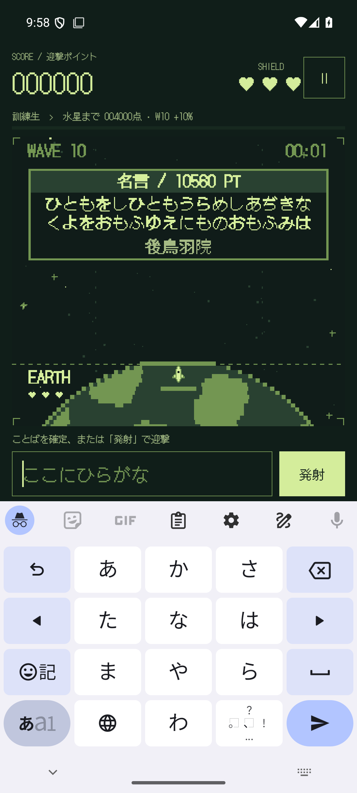
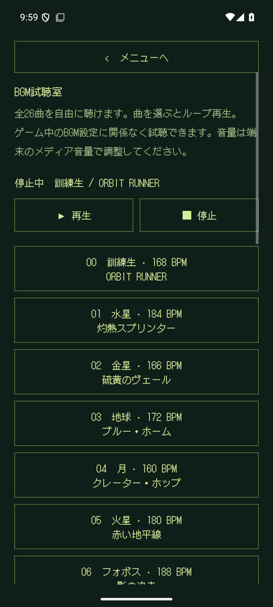
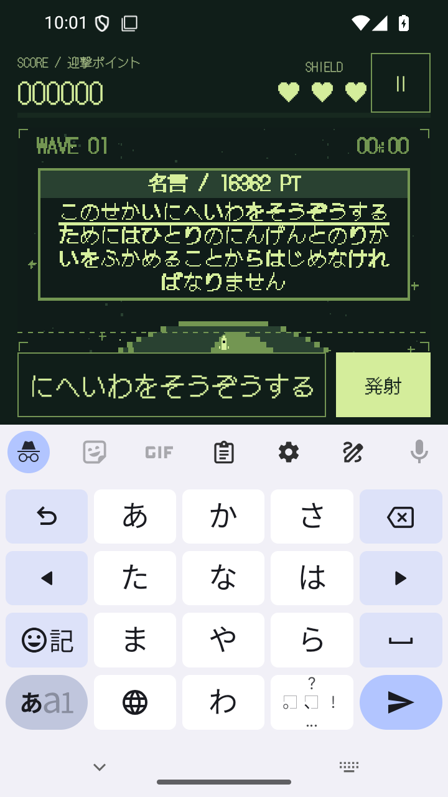

# ROCKETBOY 1.3.0 検証記録

確認日：2026-09-09。versionCode 5。数値と端末確認結果は [JSON](validation-1.3.0.json)。

## 今回の変更

- 開始WAVE 1〜16と通常／名言モードを設定。開始スコアは0点。
- ボーナスは **開始WAVE × 1％**。`基本点 × (100 + 開始WAVE) / 100` の整数部分を迎撃ごとに加点。進行中にWAVEが増えても率は固定。
- 通常の基本点は1字10点、名言は読み1字300点。WAVE 1／10／16開始で名言10字は3,030／3,300／3,480点。
- 名言モードは最初から名言だけを1個ずつ出題し、3回の着弾で終了。再開後もモードと開始WAVEを維持。
- BGM試聴室で訓練生＋25天体の全26曲を自由に再生。ゲームBGM設定から独立し、停止・画面移動・バックグラウンドで停止。
- 各挑戦の最高得点をTOP 10として保存。同一ミッションの途中保存で重複せず、同点は古い記録を優先。旧版で保持していた自己ベスト1件を引き継ぐ。
- Wikipediaで本文・帰属を確認した56件を追加し、計228件。全Wikipediaの網羅や3,000件への到達はしていない。[調査範囲](../data/quotes/wikipedia-expansion.json)。

## 確認結果

| 確認 | 結果 |
|---|---|
| 単体テスト | 37件成功、失敗・エラー・スキップなし |
| Android通常画面 | 29項目確認、未解決失敗なし。1080×2400 / 420dpi |
| Android小型画面 | 7件成功。720×1280 / 320dpi。終了後にサイズ・密度を元に戻した |
| lintDebug | エラー0、警告31。文字列連結、依存更新候補、縦画面固定など |
| Wikipedia固定版の再照合 | 101記事・228件、失敗0 |
| APK内データ | 228件、全出典がWikipedia固定版URL。旧削除名言189件はID・読みだけを移行用に保持 |
| 音源 | 26曲のファイルを1.2.1と比較し、すべて同一。25天体のMediaPlayer再生・ループと試聴室の再生停止を検証 |
| エミュレーター再インストール | 1.3.0 / code 5、APKハッシュ一致、起動成功 |
| Pixel 10a更新 | 1.2.1から上書きインストール成功。保存設定ファイルが更新前後でバイト一致。APKハッシュ一致、起動成功 |

通常画面の一括テストは28件成功、称号ラベルを照合する1件が旧表示の期待値で失敗した。WAVEとボーナスを含む新表示にテストを修正し、同じAPKに対する個別再実行で成功した。したがって全29項目について最終的な成功を確認している。最初の一括試行はActivityScenarioの起動待ちで止まったため終了し、上記の完走した試行で確認した。スクロール不要な画面にもスクロールを要求していた新規テストも修正し、通常・小型の両画面で確認した。

小型画面では開始設定、設定の取消・旧セーブ移行、TOP 10、BGM試聴、最長54字の名言入力・解説、6カテゴリの出典・ライセンス、タイトルとIMEを検証。実機での手入力による遊び心地の最終確認はユーザー側で行う。実機へのキー・タッチ入力の注入はしていない。

## インストール用APK

[ROCKETBOY-1.3.0-debug.apk](../artifacts/1.3.0/ROCKETBOY-1.3.0-debug.apk)

- パッケージ：`io.github.hatake716.rocketboy`
- サイズ：21,433,796 bytes
- 署名：Android debug、APK Signature Scheme v2
- SHA-256：`f1409c34bd1f8b65158ae6ed5583c57c143a187281cc2e762ebed439a060ea91`
- エミュレーター・Pixel 10aとも、このファイルとのハッシュ一致を確認。

## 操作画面

検証用の得点・収集状態を準備したエミュレーターの実画面。

  

  

## 再実行

```bash
python3 tools/quotes/build_catalog.py
python3 tools/quotes/verify_wikipedia_sources.py --refresh
./gradlew :app:testDebugUnitTest :app:lintDebug :app:assembleDebug
ANDROID_SERIAL=emulator-5554 ./gradlew :app:connectedDebugAndroidTest -Pandroid.injected.device.serial=emulator-5554
```

NixOSのaapt2上書きはREADMEを参照。UIテストは対象アプリのテスト用記録を初期化するため、日常利用の実機では実行しない。詳細なログ、XML、署名確認、更新前後の非公開保存データの比較用ファイルは、Git対象外の `artifacts/1.3.0/` に保存した。
