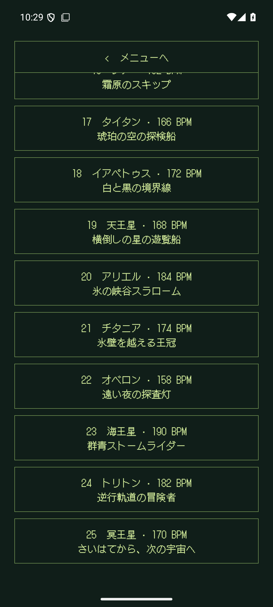
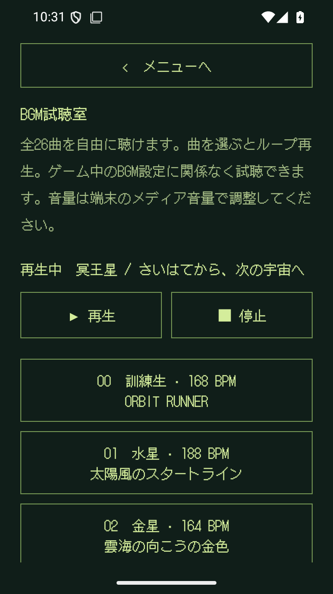

# ROCKETBOY 1.3.1 検証記録

確認日：2026-09-09。versionCode 6。詳細な測定値は[JSON](validation-1.3.1.json)。

## 今回の変更

訓練生のORBIT RUNNERを維持し、25天体のBGMを新しい「CELESTIAL ADVENTURE」に置き換えた。全曲の和声は♭VI → ♭VII → i → i。3つの4小節主題を64小節に展開し、152〜194 BPM・約79〜101秒でループする。[全25曲の曲目と制作方法](SOUNDTRACK.md)。BGM試聴室の曲名とテンポ、設定の音楽クレジットを更新した。

## 確認結果

| 確認 | 結果 |
|---|---|
| 音源の変更範囲 | 天体BGM25曲がすべて変更。訓練生と効果音5種は1.3.0 APKおよび変更前ファイルとバイト一致 |
| 和声 | 全1,600小節でベースの根音と伴奏のコード構成音を検証 |
| 曲の区別 | 調の違いを除いた主旋律・リズムの列も25曲すべて異なる |
| 発音 | 各声でイベントの重複がなく、最大4声。打楽器はノイズ1声を共有 |
| 音源ファイル | 全25曲の実際のOggをデコード。長さ・44100 Hzモノラル・有限値・クリッピング・250ms単位の無音欠落・ループ境界を検査 |
| 音量 | デコード後のRMSは約0.188〜0.192、ピーク最大約0.802。ループの境界の振幅差は最大約0.0148 |
| 再生成 | 地球を譜面から再生成して同一のOggハッシュを確認。試作出力が同梱音源を変更しないことも確認 |
| Android音源 | MediaPlayerで25曲すべてを再生し、終端を越えてループすることを確認 |
| Android操作 | 昇格・複数ランク通過・中断復元・訓練生への復帰、ミュート切替、試聴室の未到達ランク再生・停止・再開・画面移動・バックグラウンド停止を確認。計5項目 |
| 小型画面 | 720×1280 / 320dpiで試聴室の操作1件成功。曲名と再生状態・操作ボタンを画像でも確認 |
| 単体テスト | 37件成功、失敗・エラー・スキップなし |
| lint | エラー0、警告31 |
| APK内の名言データ | 1.3.0とバイト一致 |
| エミュレーター | 1.3.1 / code 6、同一APKのハッシュ・起動成功を確認。解像度・密度を元に戻した |
| Pixel 10a | データを維持して上書き更新。更新前後の設定ファイルがバイト一致。同一APKのハッシュと起動成功を確認 |

一括試行はタイトル画面のアニメーションとActivityScenarioのidle待機が重なり、4件目の開始待ちで進まなくなったため終了した。残りは別起動で検証した。試聴室ではスクロール後のUiObject2のタップが届かない例も確認し、テストで位置の安定を待ってUiDeviceの同期タップを使うよう修正した。通常画面と小型画面で停止・再開まで成功している。途中の試行・診断ログを残し、最終的に同じアプリAPKで上記5項目の成功を確認した。

実機でのスピーカー・イヤホンによる聴感評価はユーザー側で行う。物理端末へのタッチ・キー入力の注入はしていない。音源の構成はゲームボーイを参考にしたソフトウェア合成で、実機APUの完全エミュレーションや実機録音ではない。

## 成果物

- [確認用APK](../artifacts/1.3.1/ROCKETBOY-1.3.1-debug.apk) — 33,547,882 bytes、Android debug署名（APK Signature Scheme v2）
- [代表6天体・90秒の試聴MP3](../artifacts/1.3.1/CELESTIAL-ADVENTURE-90sec-preview.mp3)
- [新曲25曲のOgg音源セット](../artifacts/1.3.1/ROCKETBOY-CELESTIAL-ADVENTURE-25-tracks.zip)
- APK SHA-256：`c3241854d589932489d6db390f9754511a453414764523d1181f1b418a510882`

試聴MP3は15秒ずつ、地球・月・木星・土星・天王星・冥王星の順。各天体の主題6秒とサビ9秒をつないでいる。全25曲は合計約37分10秒。

## 画面

  

## 再検証

```bash
python3 tools/music/render.py
./gradlew :app:assembleDebug :app:assembleDebugAndroidTest :app:testDebugUnitTest :app:lintDebug
```

AndroidのUI検証はエミュレーターのみ。テストで設定・記録を初期化するため日常利用の実機では実行しない。今回の計測・ログ・生成WAV・イベント譜・APKはGit対象外の `artifacts/1.3.1/` に保存。過去の機能検証は[1.3.0](validation-1.3.0.md)を参照。
