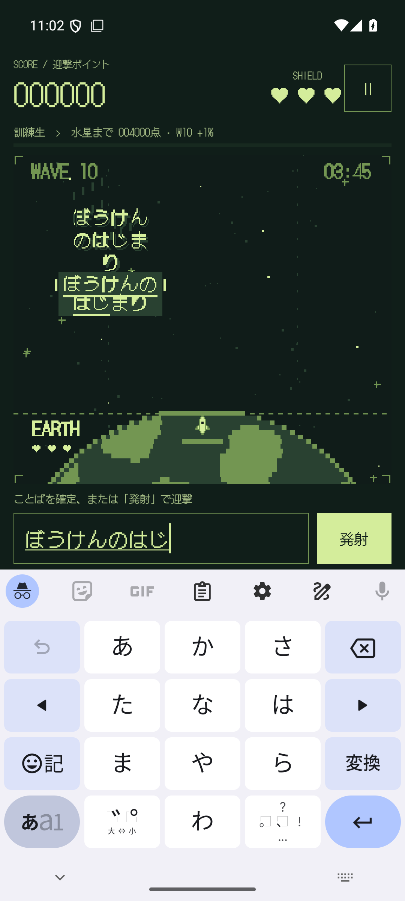

# ROCKETBOY 1.4.2 検証記録

2026-09-09 / versionCode 9 / `io.github.hatake716.rocketboy`

## 修正

通常の隕石の読みが2行以上になると、入力済み部分の下線が1行目にしか表示されない問題を修正しました。`PixelScene.drawKana` が1行目の文字数だけを取り出して下線を描いていたことが原因です。

各行の開始位置と入力済み文字数から下線の長さを求め、その行の文字幅に合わせて中央配置します。短い最終行、文字の削除、誤入力、カタカナの正規化、迎撃予約済みの表示も確認しました。スコアやゲームルール、音源、名言データの変更はありません。

## 検証結果

| 確認 | 結果 |
|---|---|
| 修正前の再現 | 「ぼうけんのはじまり」の6文字目で2行目の下線が欠け、描画テストが失敗 |
| Android Canvas描画テスト | 2件成功。1〜4行、左右2レーン、320×400 / 320×220の論理画面、各文字の入力と削除を実際の描画ピクセルで確認 |
| 日本語IMEとの接続 | 1080×2400 / 420dpiで2行目の途中入力、全文の変換中表示、確定後の迎撃・90点加算・入力欄のクリアを確認 |
| 長い名言・小型画面 | 720×1280 / 320dpiで最長の名言の続き入力、迎撃・加点、収集、再生成後の保持を確認 |
| release APK | R8適用・debuggable=falseのAPKでも、途中入力の下線・全文入力・発射・90点加算を確認 |
| 単体テスト | 41件成功、失敗・エラー・スキップ0 |
| lintRelease | エラー0、警告35（既存と同数） |
| 配布ファイル | debug APK / release APK / AABのビルド、APK署名、AAB署名・bundletool validate、release APKのZIP alignmentを確認 |
| データ | 3成果物とも音源31ファイルと名言TSVがソースとバイト単位で一致 |

描画・入力の検証にはAndroid 15 / API 35の一時エミュレーター `emulator-5556` を使いました。既存AVDを `-read-only -no-snapshot` で起動し、検証用に隕石を固定配置しました。別途起動中のエミュレーターは操作していません。実機での入力操作も行っていません。

release確認用テストの初回は、空の入力欄がアクセシビリティ上でヒント「ここにひらがな」として返るため、空文字の比較が失敗しました。テスト側の期待値を修正し、再実行で成功しています。アプリ側の変更は不要でした。

## 画面

 

実際のアプリ描画です。入力接続の `setComposingText` により「ぼうけんのはじ」まで入力した状態と、全文を入力した状態を再現しています。

## 成果物

- 実機確認用：`artifacts/1.4.2/ROCKETBOY-1.4.2-debug.apk`。以前の実機確認用1.4.0と署名証明書が一致しています。
- release APK：`artifacts/1.4.2/ROCKETBOY-1.4.2-release.apk`。1.4.1の公開準備で使用したアップロード鍵で署名。
- Google Play用AAB：`artifacts/1.4.2/ROCKETBOY-1.4.2-release.aab`。
- R8 mapping：`artifacts/1.4.2/mapping.txt`。
- 署名・サイズ・SHA-256：[build-artifacts.json](build-artifacts.json)。検証ログ：`artifacts/underline-fix-1.4.2/`。

追加でユーザーの指示を受け、Pixel 10aへ実機確認用APKを上書きインストールしました。既存1.4.0と署名が一致することを確認し、`adb install --no-incremental -r` で1.4.2 / code 9へ更新しています。起動前の保存設定・スコア・収集記録・中断データを含む `rocketboy.xml` は更新前後でバイト単位で一致しました。端末から取得したAPKのSHA-256もテスト済みAPKと一致し、MainActivityの起動と前面表示を確認しています。実機での入力操作による下線の確認は未実施です。記録は `artifacts/underline-fix-1.4.2/physical/` に保存しました。

GitHubへのアプリ更新、Google Playへのアップロードは今回行っていません。1.4.1のGoogle Play資料ZIPはその版の記録として保持しています。AABは構造・署名・内容を確認しましたが、今回AABから生成したAPKの動作検証は行っていません。
