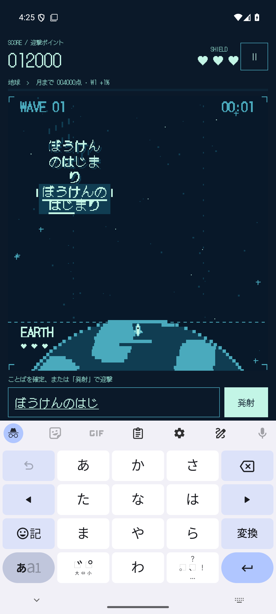
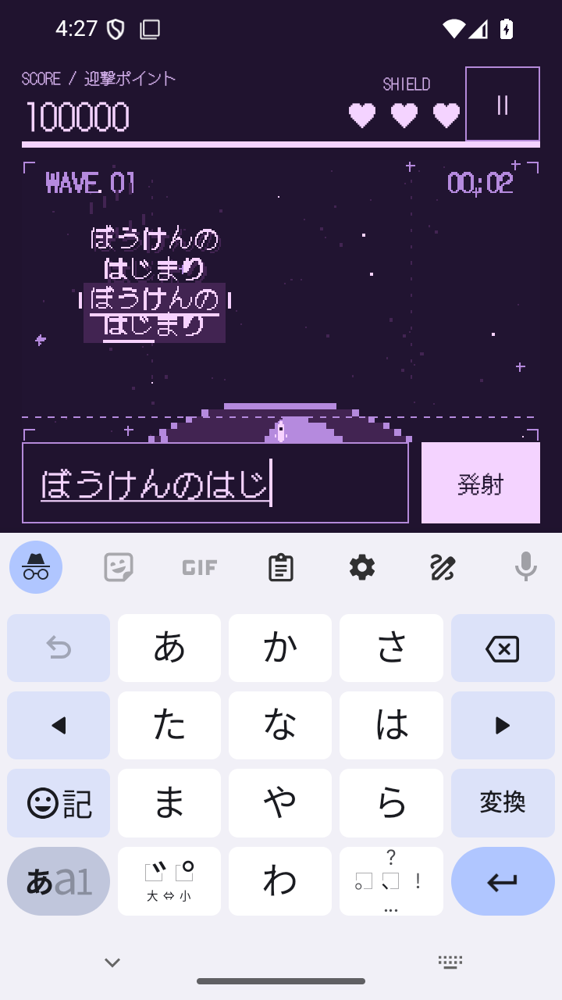
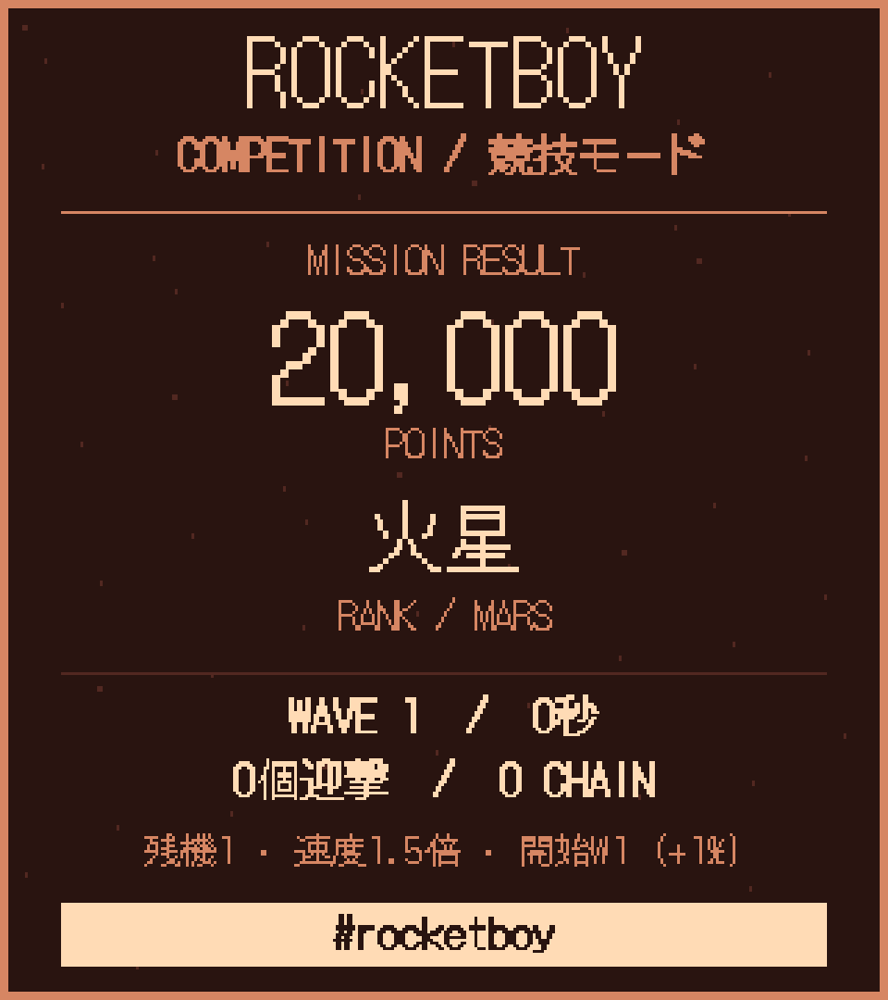

# ROCKETBOY 1.5.0 検証記録

2026-09-16 / versionCode 10 / `io.github.hatake716.rocketboy`

## 変更

訓練生の緑に加え、25天体それぞれの配色を実装しました。プレイ中は現在のスコア、タイトルとメニューは自己ベスト、競技結果と共有用PNGはその結果のスコアから選択します。[全配色の一覧](PALETTES.md)。

色セットは画面ごとに参照する不変データです。ランクアップ時には既存のViewの色を更新し、日本語IMEの変換状態や入力フォーカスを維持します。新規開始・再挑戦は緑に戻り、途中再開と結果の再生成では保存スコアの色を復元します。セーブ形式・配点・名言データ・BGM・効果音は変更していません。

## 確認結果

| 確認 | 結果 |
|---|---|
| 単体テスト | 44件成功。全26配色、4,000点の境界、冥王星の上限、色の重複・不透明度、文字と背景のコントラストを含む |
| lintRelease | エラー0、警告35（前版と同数） |
| Androidの実描画 | 全26配色で通常隕石・名言の2行目の下線、競技スコア画像の背景色と独立性をピクセルで確認 |
| 実際のプレイUI | 全26配色で背景・スコア等のラベル・入力欄・ボタン・進捗バーが更新。入力欄の同一性・変換中テキスト・フォーカスを維持 |
| ランクの遷移 | 実際の迎撃で3,990→4,010点、長い名言で複数ランク上昇、一時停止・再生成・保存再開・通常結果・再挑戦を確認 |
| 最高記録との分離 | 自己ベスト冥王星のタイトルから新規開始すると訓練生の緑。低いランクの挑戦を再開すると、その挑戦の色 |
| 競技結果 | 自己ベストは冥王星でも、20,000点の競技結果・共有PNGは火星色。結果画面の再生成後も火星色、再挑戦は緑 |
| 画面サイズ | 1080×2400 / 420dpiと720×1280 / 320dpiの両方で全26ランクのUIと変換状態を確認 |
| 下線の回帰テスト | 1.4.2で追加した2件が成功。1〜4行、左右レーン、入力・削除・誤入力・カタカナを確認 |
| release APK | R8適用・debuggable=falseの配布APKで冥王星のタイトル→地球色の途中再開→迎撃で月色→最高記録の冥王星色へ戻る操作を確認 |
| 配布ファイル | debug APK / release APK / AABのビルド、APK署名、AAB署名・bundletool validate、release APKのZIP alignmentを確認 |
| 内容 | 3成果物とも音源31ファイルと名言TSVがソースとバイト単位で一致 |

Androidテストは7種類、画面サイズを変えた再実行を含め8件成功。API 35の一時エミュレーター `emulator-5556` を `-read-only -no-snapshot` で起動し、検証用にスコアと隕石を配置しています。配色画像は実際のCanvas描画、プレイ画像はアプリ画面のキャプチャです。

  

## 成果物と確認範囲

- 実機確認用：`artifacts/1.5.0/ROCKETBOY-1.5.0-debug.apk`。1.4.2の実機確認用APKと署名証明書が一致。
- 配布APK：`artifacts/1.5.0/ROCKETBOY-1.5.0-release.apk`。
- Google Play用：`artifacts/1.5.0/ROCKETBOY-1.5.0-release.aab`。
- R8 mapping：`artifacts/1.5.0/mapping.txt`。
- サイズ・SHA-256：[build-artifacts.json](build-artifacts.json)。検証ログ：`artifacts/palettes-1.5.0/`。

Pixel 10aへ1.5.0を上書きインストール済み。同じdebug署名を確認し、初回起動前の保存データが更新前後でバイト一致、インストール済みAPKが検証済み成果物と一致することと、正常起動を確認しました。実機へのゲーム入力は行っていません。GitHubへのアプリ更新、Google Playへのアップロードは未実施です。Google Play更新資料の準備時にAAB由来APKで追加の1テストが成功し、8枚のストア画面を撮影しました。コールド起動後の最高記録も確認しました。[更新版の検証](PLAY_VALIDATION.md)。以前の版の成果物と1.4.1のGoogle Play資料ZIPは保持しています。
