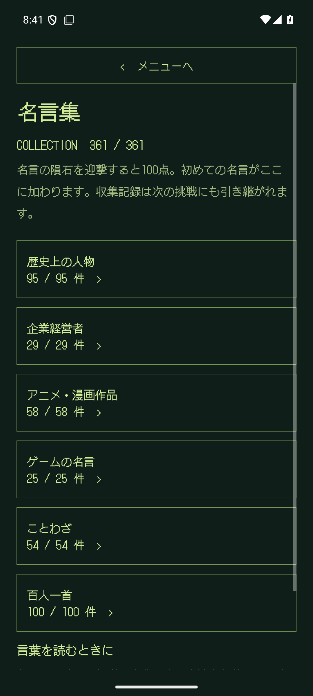
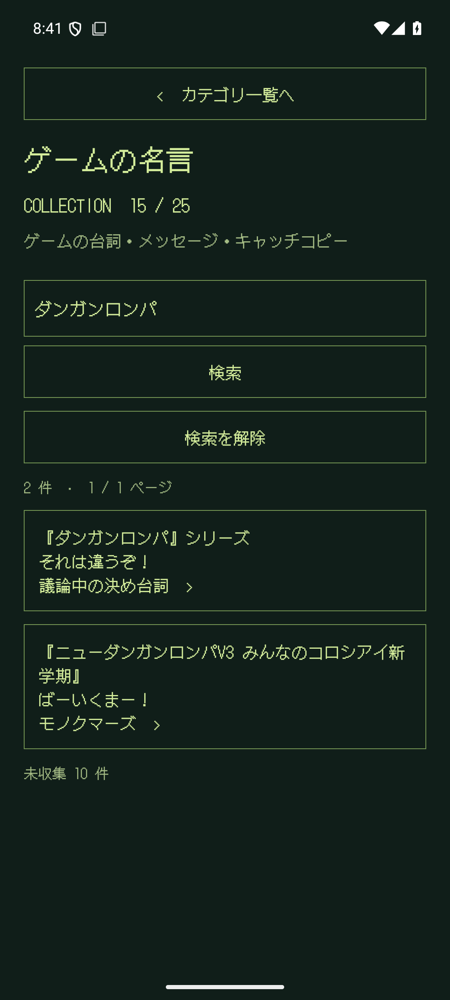
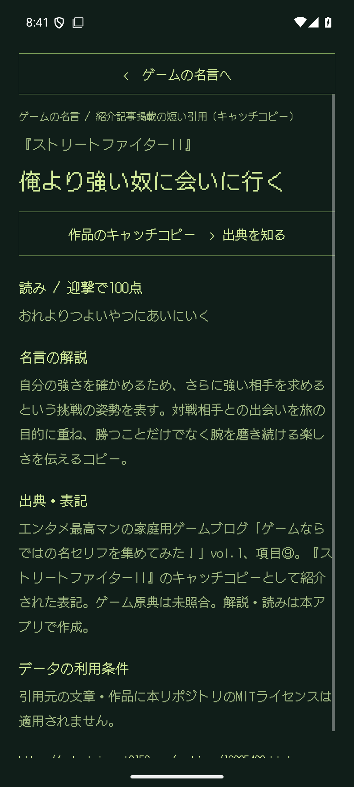
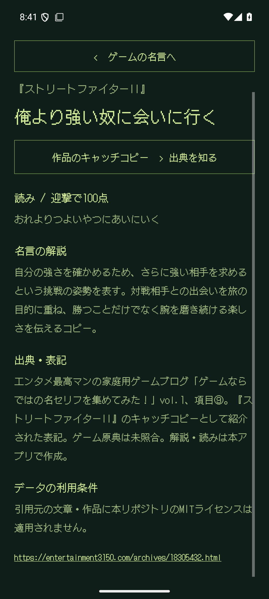
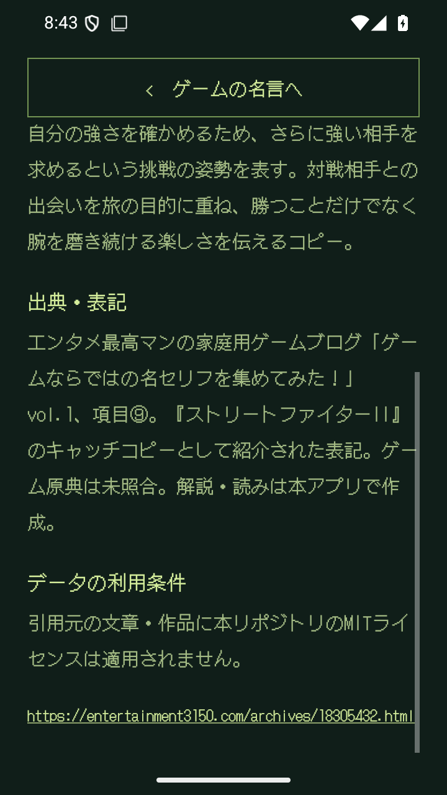

# ゲームブログ5記事からの15件追加・検証記録

確認日：2026-09-09。1.1.0 / code 2 の確認用debug APK。
[機械可読の検証結果](validation-entertainment-quotes.json)。

## 内容とデータ

指定された5記事から各3件、計15件を追加。ゲームカテゴリ25件、総収録361件。
全件に入力用の読み・独自解説・人物または作品の紹介・記事URLと項目番号を付けた。
7件は作品への帰属として扱い、「出典を知る」から説明に進む。1件は掛け合いの一部抜粋。
引用と記事内の番号付き項目の一致、5記事のHTMLのSHA-256を確認した。ゲーム原典は未照合。
[項目別の出典](ENTERTAINMENT_QUOTES.md)。

前回APKの名言・人物TSVが今回APKの先頭にそのまま含まれることを比較し、旧346件の既存データを保持していることを確認。
今回のAPKにはTSV353件＋旧版コード内8件が含まれ、生成元TSVとのバイト一致を確認した。

`python3 tools/quotes/build_catalog.py --require-target` は終了コード1。3,000件に2,639件不足しており、全体の収録目標は未達。

## ビルドと画面

`assembleDebug`、`assembleDebugAndroidTest`、`testDebugUnitTest`、`lintDebug` が成功。
単体テスト28件成功。lintはエラー0、警告24件。

Android 15 / API 35 / `emulator-5554` の1080×2400・420dpiで全23件成功。
新規の検証では、作品名検索、ゲーム内の決め台詞とキャッチコピーの区別、解説、出典リンク、作品紹介、既存の未収集項目が勝手に解放されないことを確認。
従来の迎撃・100点加算・収集の永続化・旧セーブ互換・他カテゴリも含む全体の回帰テストが成功した。

720×1280・320dpiでは、新規の作品帰属・検索・解説・出典の画面テスト1件を再実行して成功。
実画面を確認後、画面設定を元の1080×2400・420dpiへ戻した。

初回の全体実行では、9件終了後に既存テストの起動待ちが進まなくなったため、テスト対象アプリを終了して中断。
コードを変えず全23件を再実行して成功した。初回の中断ログもAPKと同じ成果物ディレクトリに保存。

## APK

- ファイル：`artifacts/entertainment-quotes-preview/ROCKETBOY-entertainment-quotes-preview.apk`
- サイズ：5,780,880 bytes
- SHA-256：`25687f8cd57fa4d959d3877fae67ddfa7592e0f059503c2d69aeb31c5be90995`
- 署名：Android debug / APK Signature Scheme v2、検証成功。
- エミュレーターへ最終APKを再インストールし、インストール済みAPKのSHA-256一致を確認。
- 実機検証と本番署名による公開用ビルドは未実施。

## 実画面

収集状態は表示テスト用に準備したもの。画像はエミュレーターの実画面で、全件を自然出現で獲得した記録ではない。

  

 
