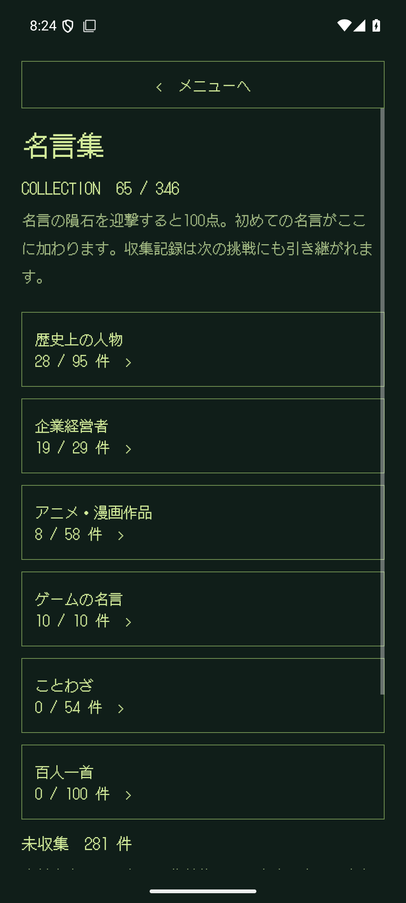
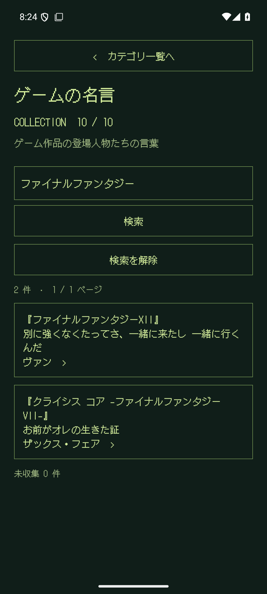
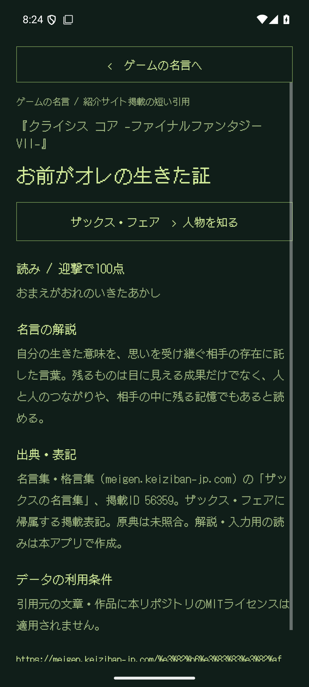
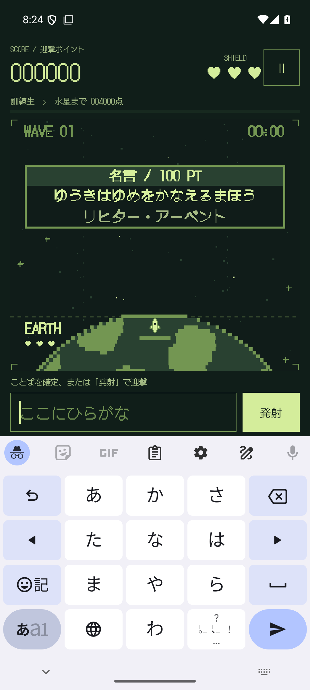
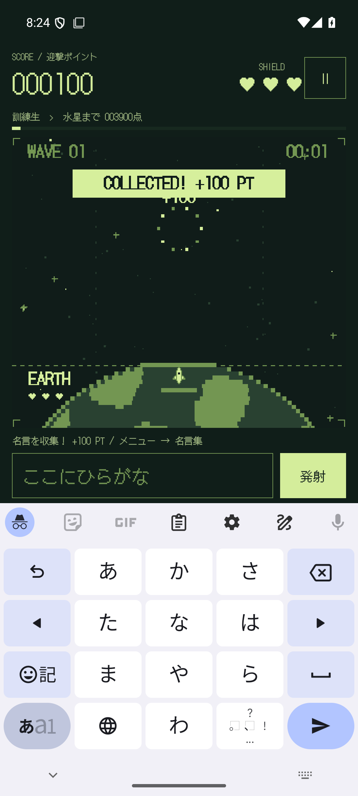
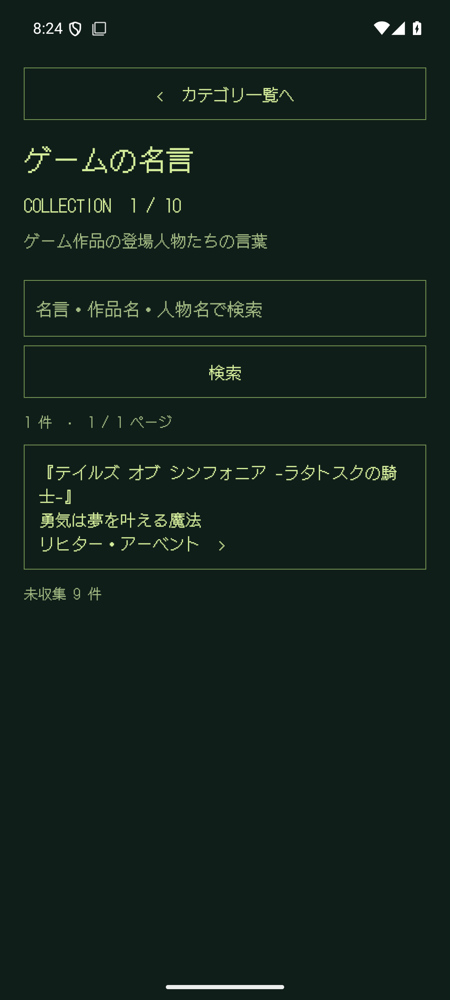
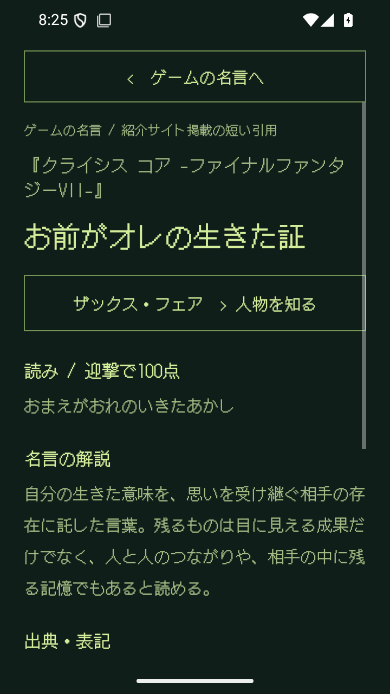
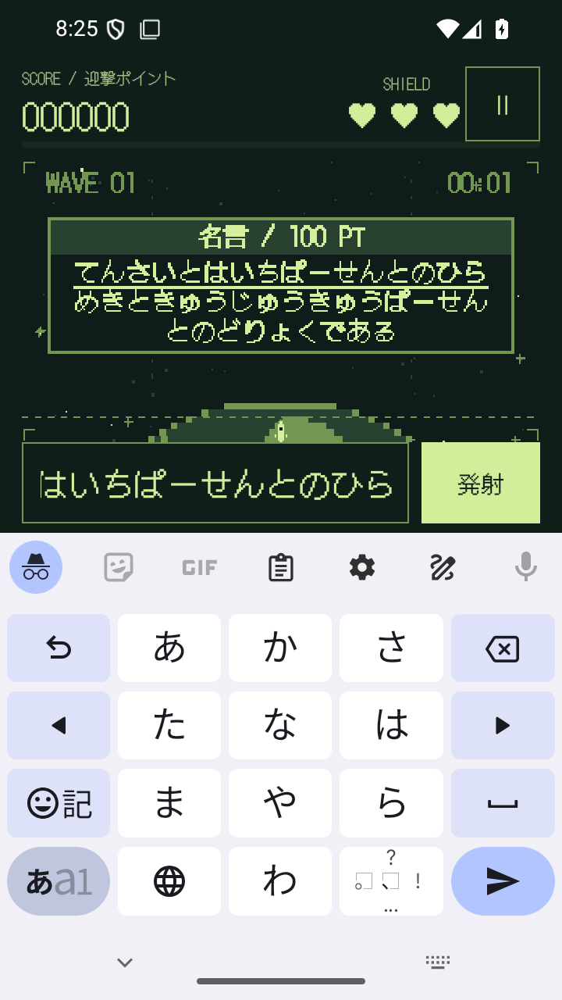

# ゲームカテゴリと名言64件追加の検証

確認日：2026-09-09。ROCKETBOY 1.1.0 / versionCode 2 の確認用debug APK。
機械可読の結果は [validation-game-quotes.json](validation-game-quotes.json)。

## 実装内容

- 新設「ゲームの名言」カテゴリに、指定サイトから9件、既存の原作ゲーム台詞1件を収録。
- 指定サイトの64記事から各1件を追加。歴史28、企業19、アニメ漫画8、ゲーム9。
- 本文、入力用のひらがな、独自の個別解説、人物・作品名、記事内の掲載ID付き出典URLを収録。
- 17件の一部抜粋を明記。64件とも掲載人物欄・本文の一致、取得時HTMLのSHA-256を確認。
- 原典の発言や実際のゲーム内テキストとの照合は未実施。紹介サイトで確認した範囲を各項目に表示。
- 既存 `animate-sogo-music` は本文・読み・人物ID・名言IDを維持してGAMEへ移動。
- ゲーム作品名で検索でき、詳細に作品名・登場人物名を表示。

## ビルドとデータ検証

`assembleDebug`、`assembleDebugAndroidTest`、`testDebugUnitTest`、`lintDebug` が成功。
単体テスト27件成功。debug lintはエラー0、警告24件。
名言の重複ID・重複本文・重複読み・人物参照・入力制限・解説・出典を検査した。
APK内のTSV338件と旧版コード内8件で計346件。APK内の名言・人物TSVが編集元からの生成物とバイト単位で一致。

```sh
python3 tools/quotes/build_catalog.py
python3 tools/quotes/verify_keiziban_sources.py --html-dir /tmp/rocketboy-keiziban
```

`--require-target` は346件のため終了コード1。目標3,000件に2,654件不足し、全体の収録作業は未完了。

## エミュレーターでの確認

Android 15 / API 35 / `emulator-5554` / Gboard。
1080×2400・420dpiで22件の画面テストが成功。720×1280・320dpiで次の2件が成功。

- ゲームカテゴリの旧収集ID維持、作品名検索、詳細・解説・出典の閲覧。
- 最長の名言を部分入力しても発射しないこと、全文入力後の迎撃・100点加算・収集保存・再起動後の維持。小画面と実キーボードの共存。

標準画面の全検証では、今回のゲーム名言自体も迎撃して確認した。
最後の文字を入力してロケットを発射した時点では0点・未収集、命中後に100点・収集済みとなり、再起動後もゲームカテゴリに残る。
既存のアニメ・漫画検索、世界の偉人、百人一首、ページ切り替え、旧ミッション復元も成功。

初回の新規画面テスト1件で、画面再生成直後に次のボタンを押す同期不足を検出。
フォーカス・レイアウト・遷移先ボタンの表示を待つようテストを修正し、全22件を再実行して成功した。

検証後に画面設定を1080×2400・420dpiへ戻し、以下のAPKを再インストール。
インストールされたAPKのSHA-256が配布ファイルと一致することを確認。実機での検証は未実施。

## 確認用APK

- ファイル：`artifacts/game-quotes-preview/ROCKETBOY-game-quotes-preview.apk`
- サイズ：5,778,088 bytes
- SHA-256：`1c844ecd1b60c59e74c369e9a96a91b5b6e8bba070d85cfc1d46a5bc9a78e218`
- 署名：Android debug、APK Signature Scheme v2で検証成功。
- 版：1.1.0 / code 2。本番公開用の署名済みリリースではない。

## 画面

収集一覧用の65件の獲得状態と迎撃対象はテストで準備したもの。プレイヤーが自然出現で全件を集めた記録ではない。
画像は描いた見本ではなく、エミュレーター上のアプリ実画面。

  

  

 
